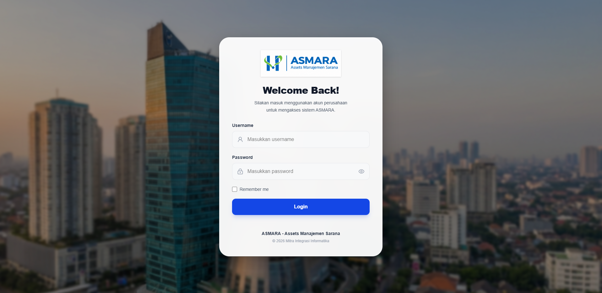
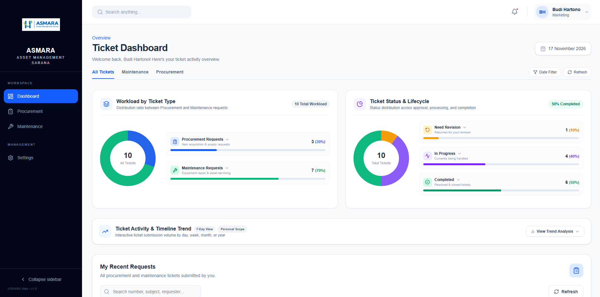
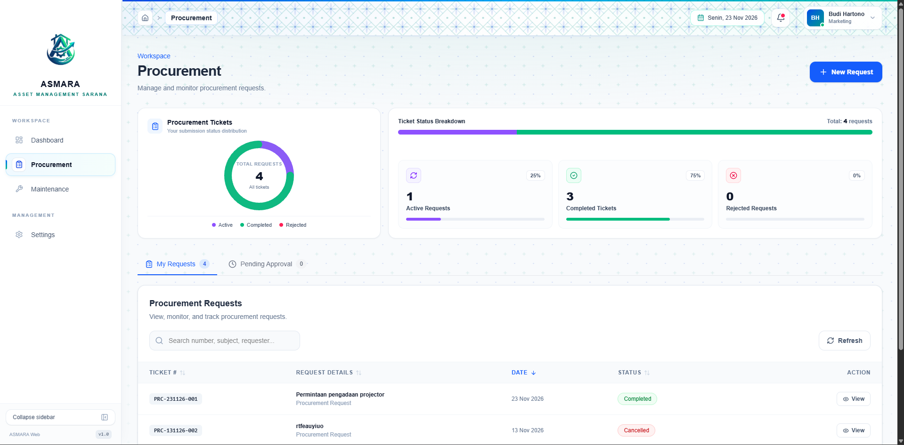
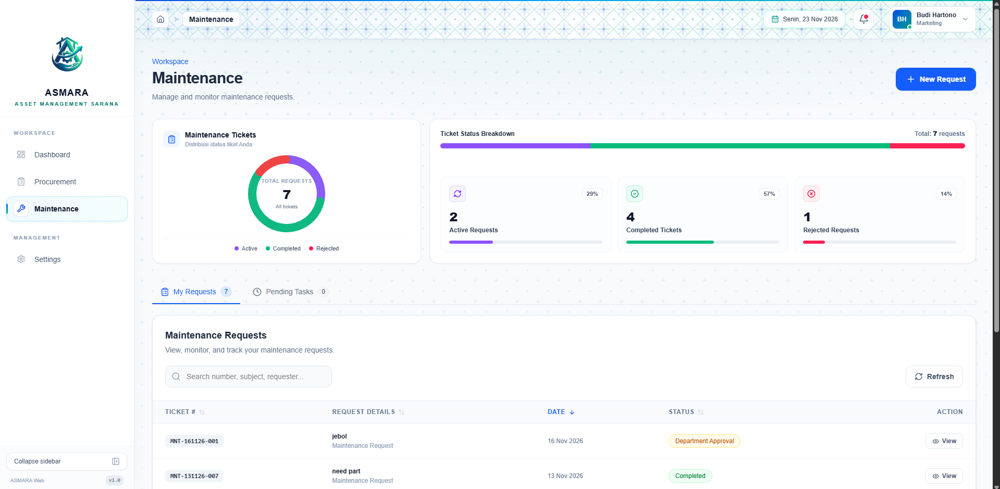
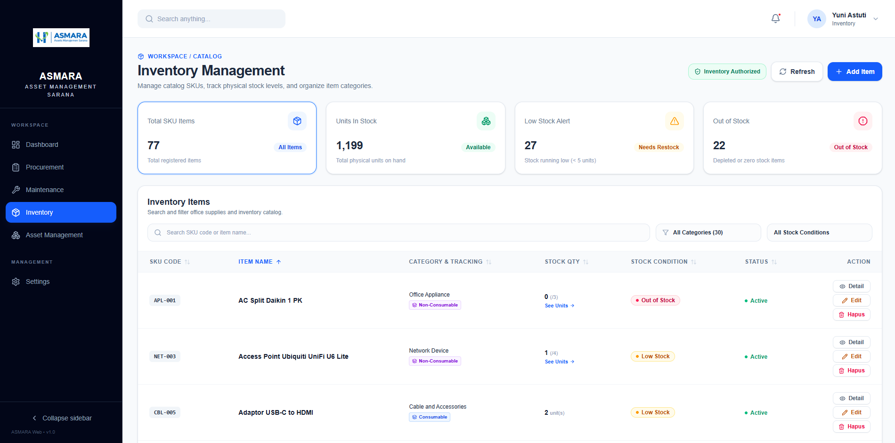
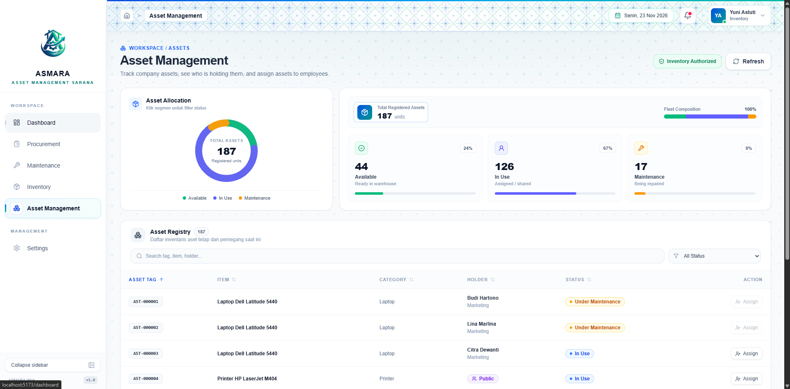
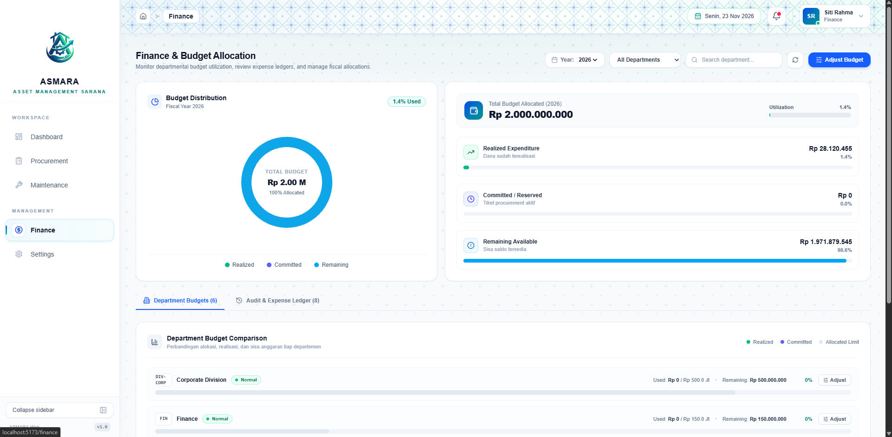
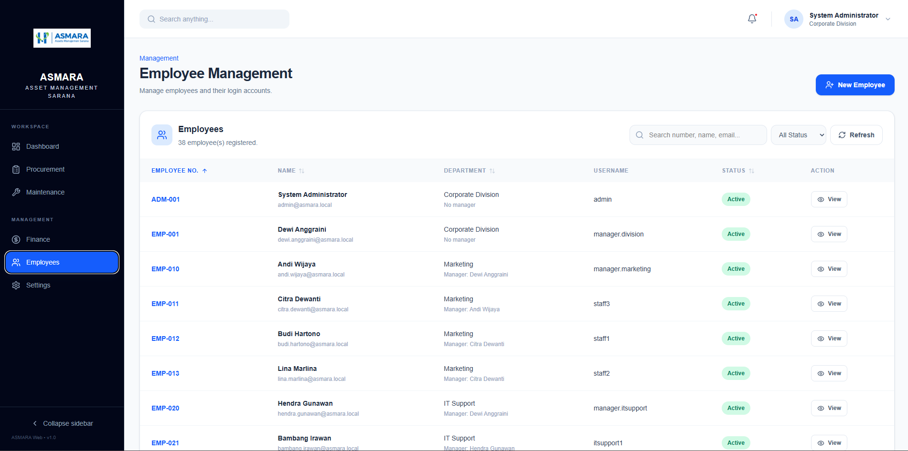
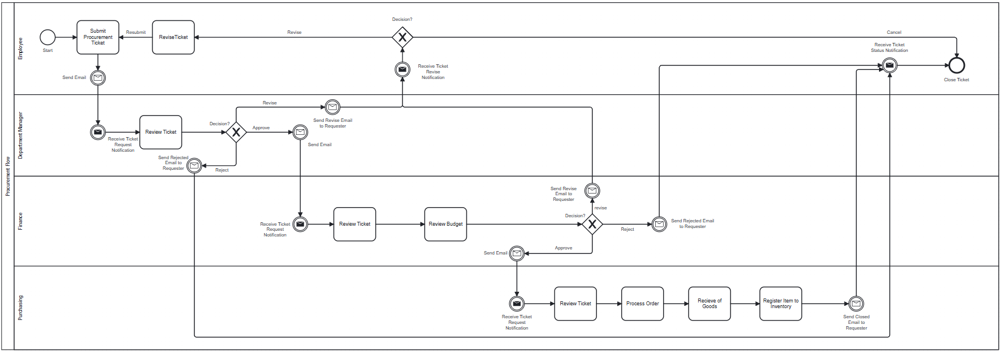
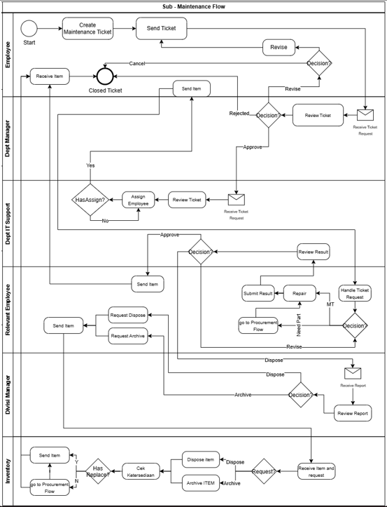

# ASMARA.WEB — Assets Manajemen Sarana


**ASMARA (Assets Manajemen Sarana)** adalah aplikasi web frontend berbasis **React + TypeScript** untuk mengelola siklus hidup aset perusahaan secara terintegrasi—mulai dari pengadaan barang (*Procurement*), pemeliharaan dan penggantian aset (*Maintenance*), pengelolaan stok gudang (*Inventory*), penugasan aset (*Asset Management*), pengawasan anggaran departemen (*Finance*), hingga administrasi karyawan.

---

## Daftar Isi

- [Fitur Utama](#fitur-utama)
- [Alur Workflow](#alur-workflow)
- [Rute & Kontrol Akses Role](#rute--kontrol-akses-role)
- [Teknologi yang Digunakan](#teknologi-yang-digunakan)
- [Struktur Proyek](#struktur-proyek)
- [Instalasi & Menjalankan Secara Lokal](#instalasi--menjalankan-secara-lokal)
- [Repositori Terkait & Tim Pengembang](#repositori-terkait--tim-pengembang)

---

## Fitur Utama

### 1. Autentikasi & Manajemen Sesi
- Login dengan dukungan *Remember Me* berbasis refresh token cookie (`withCredentials`).
- Penyimpanan *access token* pada `sessionStorage` dan mekanisme *silent refresh* otomatis melalui Axios response interceptor saat menerima status `401 Unauthorized`.
- Pemisahan route guard (`GuestRoute` dan `ProtectedRoute`) serta pembatasan menu dan halaman berdasarkan role (*Role-Based Access Control*).

<!-- TODO: Tambahkan gambar halaman Login -->


### 2. Dashboard & Analitik (`/dashboard`)
- Kartu statistik tiket (*Total*, *Active*, *Closed*, *Rejected* / sesuai cakupan akses role).
- Grafik interaktif **Ticket Type Distribution** & **Ticket Status Distribution** lengkap dengan panel *Top Tickets* dan navigasi *deep-link* langsung ke detail tiket.
- Grafik **Ticket Activity Trend**, **Department Budget Bar Chart** (khusus Finance/Admin), dan **Asset Distribution Chart** (khusus Inventory).
- Tabel **My Activity** dengan pencarian *debounced*, filter tanggal & jenis tiket, pagination, serta modal detail tiket *read-only*.

<!-- TODO: Tambahkan gambar halaman Dashboard -->


### 3. Procurement (`/procurement`)
- **Pembuatan Pengajuan 2 Langkah**: Pengisian detail & daftar item dinamis (pilih dari katalog inventory atau input manual) → layar **Review** → dialog konfirmasi (`ConfirmDialog`) sebelum submit.
- **Alur Approval Berjenjang**: Persetujuan, permintaan revisi, atau penolakan di level Department & Finance (lengkap dengan widget evaluasi anggaran departemen).
- **Employee Revision**: Banner alasan revisi dari approver, mode edit ulang detail & item pengajuan, hingga opsi pembatalan tiket.
- **Purchasing**: Pencatatan penyelesaian pembelian beserta unggah dan pratinjau file bukti pembelian.
- **Tabel & Riwayat**: Statistik tiket, pencarian *server-side* (dengan debounce), sorting kolom, pagination, serta *Ticket Workflow History*.

<!-- TODO: Tambahkan gambar halaman Procurement -->


### 4. Maintenance (`/maintenance`)
- **Pembuatan Tiket 2 Langkah**: Pemilihan aset milik pribadi/perusahaan yang tersedia → deskripsi masalah → layar **Review** → dialog konfirmasi sebelum submit.
- **Workflow Perbaikan Lengkap**:
  - Approval, penolakan, dan penugasan teknisi/handler oleh IT Support.
  - Serah-terima aset fisik (*Send Item* & *Receive Item*).
  - Pelaporan hasil perbaikan oleh handler (`Repaired`, `Unrepairable`, atau `Need Part`).
  - **Pengecekan Stok Spare Part**: Tabel perbandingan kebutuhan part dengan stok gudang secara real-time beserta penguncian opsi `Available` apabila item belum terdaftar di katalog atau stok tidak mencukupi.
  - **Pengadaan Child Ticket & Penggantian Aset**: Pembuatan child procurement untuk pembelian spare part yang kurang (*Order Part*), keputusan disposisi (`Archive` / `Dispose`), pemilihan atau pengadaan aset pengganti (*Replacement Asset*), hingga penutupan tiket (*Close Ticket*).
- **Lazy Loading Options & Optimasi Tabel**: Dropdown opsi (aset, handler, spare part, kategori, aset pengganti) hanya dimuat saat step membutuhkannya; didukung pencarian *server-side* dengan debounce, sorting kolom, dan pagination.

<!-- TODO: Tambahkan gambar halaman Maintenance -->


### 5. Inventory (`/inventory`)
- Pemantauan stok item *consumable* dan *non-consumable*, filter kategori & status stok, serta manajemen data katalog item.

<!-- TODO: Tambahkan gambar halaman Inventory -->


### 6. Asset Management (`/assets`)
- Daftar aset terdaftar beserta status dan pemegangnya (*Asset Holder*), serta penugasan aset personal atau perusahaan ke karyawan.

<!-- TODO: Tambahkan gambar halaman Asset Management -->


### 7. Finance (`/finance`)
- Ringkasan anggaran keseluruhan, daftar anggaran per departemen, penyesuaian anggaran (*Budget Adjustment*), dan riwayat log perubahan anggaran (*Budget Log*).

<!-- TODO: Tambahkan gambar halaman Finance -->


### 8. Employees (`/employees`)
- Manajemen data karyawan, aktivasi akun, dan pengaturan role pengguna (khusus Admin).

<!-- TODO: Tambahkan gambar halaman Employees -->


---

## Alur Workflow

### Workflow Procurement
<!-- TODO: Ganti path di bawah dengan gambar diagram workflow Procurement -->


### Workflow Maintenance
<!-- TODO: Ganti path di bawah dengan gambar diagram workflow Maintenance -->


---

## Rute & Kontrol Akses Role

| Rute | Deskripsi | Hak Akses |
| :--- | :--- | :--- |
| `/` | Halaman Login | Tamu (`GuestRoute`) |
| `/dashboard` | Dashboard analitik & aktivitas terbaru | Semua user terautentikasi |
| `/procurement` | Pengajuan & persetujuan pengadaan barang | Semua user terautentikasi |
| `/maintenance` | Pengajuan & penanganan perbaikan aset | Semua user terautentikasi |
| `/inventory` | Manajemen stok & katalog item gudang | Inventory (`ROL-06`) |
| `/assets` | Daftar aset & penugasan aset ke karyawan | Inventory (`ROL-06`) |
| `/finance` | Pengelolaan anggaran departemen & log budget | Finance (`ROL-04`), Admin (`ROL-09`) |
| `/employees` | Manajemen data karyawan, akun & role | Admin (`ROL-09`) |
| `/profile` | Profil pengguna yang sedang login | Semua user terautentikasi |
| `/settings` | Pengaturan akun & kata sandi | Semua user terautentikasi |

*(Catatan: Hak akses aksi spesifik di dalam alur tiket seperti Approval, Assign Handler, Purchasing, dan Inventory Check dikontrol oleh backend melalui permission flags pada setiap tiket.)*

---

## Teknologi yang Digunakan

- **Framework & Bahasa**: React 19, TypeScript 5.9
- **Build Tool & Dev Server**: Vite 7
- **Styling**: Tailwind CSS v4 (`@tailwindcss/vite`)
- **Routing**: React Router DOM v7 (dilengkapi *route-level code splitting* dengan `React.lazy` & `Suspense`)
- **HTTP Client**: Axios (dengan interceptor Bearer token & auto-refresh session)
- **Ikon**: Lucide React

---

## Struktur Proyek

```text
ASMARA.WEB/
├── public/
├── src/
│   ├── components/
│   │   ├── auth/              # Route guard (ProtectedRoute, GuestRoute, AuthLoader)
│   │   ├── common/            # Komponen UI bersama (ConfirmDialog, NoteField, ProcurementItemForm,
│   │   │                      # TicketHistorySection, RequestAlerts, table/*, dll.)
│   │   └── layout/            # MainLayout, Sidebar, Topbar
│   ├── features/
│   │   ├── assets/            # Manajemen & penugasan aset
│   │   ├── auth/              # Halaman & form login
│   │   ├── dashboard/         # Analitik, grafik distribusi, My Activity, TicketViewModal
│   │   ├── employees/         # Manajemen karyawan & role
│   │   ├── finance/           # Anggaran departemen & budget logs
│   │   ├── inventory/         # Katalog barang & manajemen stok
│   │   ├── maintenance/       # Pengajuan, inspeksi handler, part check, & replacement
│   │   ├── procurement/       # Pengajuan pembelian, revisi, approval, & purchasing
│   │   ├── profile/           # Halaman profil saya
│   │   └── settings/          # Pengaturan akun
│   ├── hooks/                 # Shared hooks (useDebouncedValue, useInventoryOptions)
│   ├── services/              # Konfigurasi Axios & manajemen sesi (api.ts, authSession.ts)
│   ├── types/                 # Tipe data bersama lintas fitur (ticket.types.ts)
│   ├── utils/                 # Helper role auth, formatters, itemForm, dan apiError
│   ├── App.tsx                # Konfigurasi route & lazy loading halaman
│   ├── index.css
│   └── main.tsx
├── index.html
├── package.json
├── tsconfig.json
└── vite.config.ts
```

---

## Instalasi & Menjalankan Secara Lokal

### Prasyarat
- **Node.js** (disarankan versi LTS v20+) dan **npm**
- Backend API **ASMARA** sudah berjalan dan dapat diakses

### Langkah Setup

1. **Clone repositori**
   ```bash
   git clone [Repositori FrontendAsmara](https://github.com/mopiprr/ASMARA.WEB.git)
   cd ASMARA.WEB
   ```

2. **Install dependensi**
   ```bash
   npm install
   ```

3. **Konfigurasi Environment Variable**
   Buat file `.env` pada root proyek (opsional jika backend berjalan di port default `http://localhost:5243`):
   ```env
   VITE_API_BASE_URL=http://localhost:5243
   ```
   > Aplikasi akan mengarahkan permintaan HTTP ke `${VITE_API_BASE_URL}/api` dan mengirim kredensial cookie (`withCredentials: true`).

4. **Jalankan server development**
   ```bash
   npm run dev
   ```

### Script yang Tersedia

| Perintah | Deskripsi |
| :--- | :--- |
| `npm run dev` | Menjalankan development server Vite |
| `npm run build` | Melakukan type-check TypeScript (`tsc -b`) dan membangun bundle produksi ke `dist/` |
| `npm run preview` | Menjalankan preview lokal dari hasil build produksi (`dist/`) |

---

## Repositori Terkait & Tim Pengembang

- **Backend Repository**: <!-- TODO: Masukkan link repo backend --> `[ASMARA.API](https://github.com/mopiprr/ASMARA)`
- **Tim Pengembang**:
  - `Mu'aafii Putra Ramadhan` — *Backend*
  - `Fran Dello` — *Backend*
  - `Muhammad Bagas Ruliansyah` — *Frontend*
